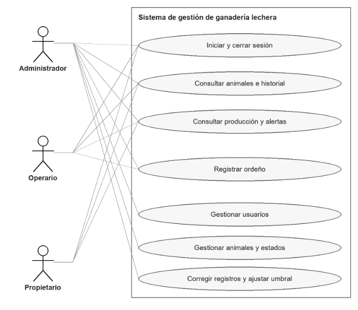
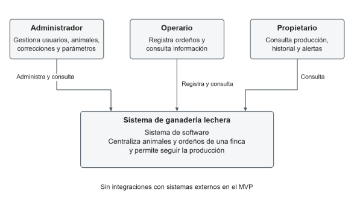
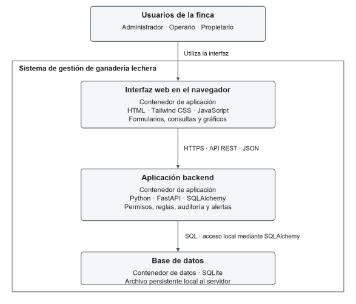
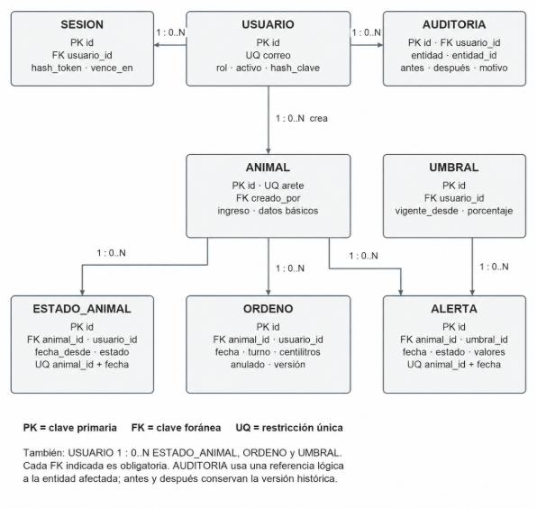
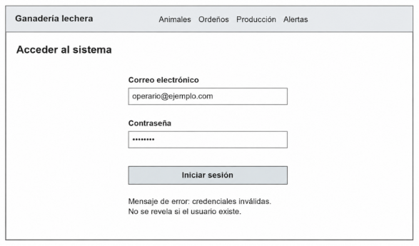
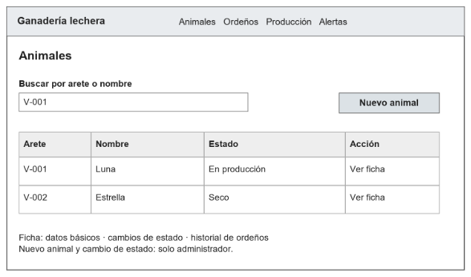
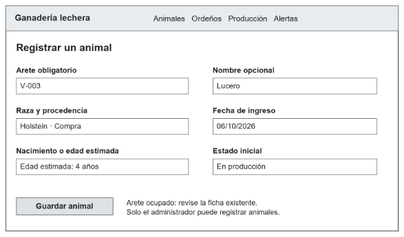
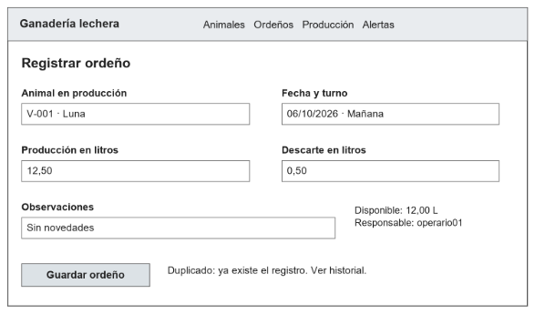
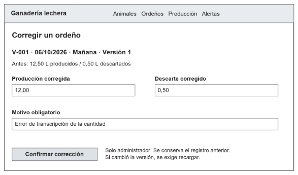
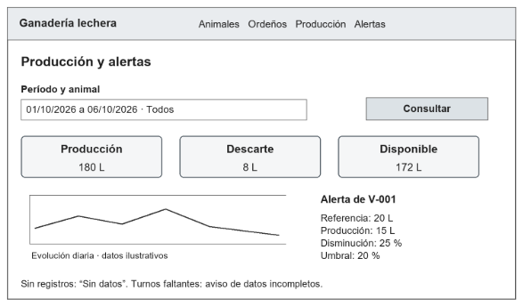

# Documento de Planteamiento y Diseño de Software

**IS873 LABORATORIO DE SOFTWARE**

**SISTEMA DE GESTIÓN DE GANADERÍA LECHERA**

**Versión:** 1.0  
**Fecha:** 13/10/2026

**Elaborado por:**

- JUAN MANUEL ALVAREZ
- FRANKY MARIN
- JUAN DIEGO NIÑO

Pereira, Risaralda - 2026

[Descargar documento original en Word](planteamiento-y-diseno.docx) · [Volver al proyecto](../README.md)

## Índice

- [1. Planteamiento del Proyecto](#seccion-1)
  - [1.1. Descripción del Problema](#seccion-1-1)
  - [1.2. Objetivos](#seccion-1-2)
    - [1.2.1. Objetivo General](#seccion-1-2-1)
    - [1.2.2. Objetivos Específicos](#seccion-1-2-2)
  - [1.3. Descripción General de la Solución Propuesta](#seccion-1-3)
    - [1.3.1. Módulos principales](#seccion-1-3-1)
  - [1.4. Alcance Inicial del Proyecto (MVP)](#seccion-1-4)
  - [1.5. Fuera del alcance inicial](#seccion-1-5)
- [2. Levantamiento de Requerimientos](#seccion-2)
  - [2.1. Requerimientos Funcionales (RF)](#seccion-2-1)
    - [2.1.1. RF01 — Gestión de Usuarios y Roles](#seccion-2-1-1)
    - [2.1.2. RF02 — Registro de Animales](#seccion-2-1-2)
    - [2.1.3. RF03 — Consulta del Historial de Animales](#seccion-2-1-3)
    - [2.1.4. RF04 — Registro de Ordeños](#seccion-2-1-4)
    - [2.1.5. RF05 — Validación de Cantidades y Duplicados](#seccion-2-1-5)
    - [2.1.6. RF06 — Control de Producción, Descarte y Volumen Disponible](#seccion-2-1-6)
    - [2.1.7. RF07 — Consulta de Producción por Animal y Período](#seccion-2-1-7)
    - [2.1.8. RF08 — Indicadores Básicos de Producción](#seccion-2-1-8)
    - [2.1.9. RF09 — Reportes Básicos](#seccion-2-1-9)
    - [2.1.10. RF10 — Registro de Modificaciones (Trazabilidad)](#seccion-2-1-10)
    - [2.1.11. RF11 — Control de Acceso por Rol](#seccion-2-1-11)
    - [2.1.12. RF12 — Registro de Salidas del rebaño](#seccion-2-1-12)
    - [2.1.13. RF13 — Alertas por disminución de producción](#seccion-2-1-13)
  - [2.2. Requerimientos No Funcionales (RNF)](#seccion-2-2)
    - [2.2.1. RNF01 — Seguridad](#seccion-2-2-1)
    - [2.2.2. RNF02 — Disponibilidad](#seccion-2-2-2)
    - [2.2.3. RNF03 — Usabilidad](#seccion-2-2-3)
    - [2.2.4. RNF04 — Rendimiento](#seccion-2-2-4)
    - [2.2.5. RNF05 — Escalabilidad](#seccion-2-2-5)
    - [2.2.6. RNF06 — Integridad de Datos](#seccion-2-2-6)
    - [2.2.7. RNF07 — Trazabilidad y Auditoría](#seccion-2-2-7)
    - [2.2.8. RNF08 — Mantenibilidad](#seccion-2-2-8)
    - [2.2.9. RNF09 — Portabilidad](#seccion-2-2-9)
    - [2.2.10. RNF10 — Pruebas y Calidad](#seccion-2-2-10)
  - [2.3. Priorización MoSCoW](#seccion-2-3)
- [3. Casos de Uso](#seccion-3)
  - [3.1. Diagrama General de Casos de Uso](#seccion-3-1)
  - [3.2. Detalle de 3 a 5 Casos de Uso Críticos](#seccion-3-2)
- [4. Diseño Preliminar de la Solución](#seccion-4)
  - [4.1. Arquitectura Preliminar](#seccion-4-1)
  - [4.2. Modelo de Datos Preliminar(Diagrama Entidad-Relación (ERD))](#seccion-4-2)
  - [4.3. Mockups / Wireframes](#seccion-4-3)
  - [4.4. Justificación del Stack Tecnológico](#seccion-4-4)

## 1. Planteamiento del Proyecto

### 1.1. Descripción del Problema

El proyecto toma como escenario una finca lechera que conserva sus registros en cuadernos y hojas de cálculo independientes. La revisión documental identifica los siguientes problemas de registro y seguimiento, pendientes de validación con usuarios de la finca:

- **Información dispersa:** los datos de identificación, producción y manejo de cada animal se encuentran en diferentes registros, lo que dificulta consultar el historial de cada vaca y consolidar la producción de un período.

- **Errores en los cálculos:** la consolidación manual de los litros producidos por día o por animal puede generar omisiones o registros duplicados.

- **Seguimiento limitado:** resulta difícil comparar la producción de una vaca entre diferentes fechas e identificar cambios que requieran revisión.

- **Falta de recordatorios**: las anotaciones aisladas dificultan el seguimiento de actividades sanitarias y reproductivas. Su atención mediante módulos y recordatorios se plantea como ampliación posterior al MVP.

- **Poca trazabilidad:** no siempre es posible saber quién registró o modificó un dato ni relacionar una novedad con el historial del animal.

La dispersión dificulta disponer de información consistente para revisar la producción y corregir errores de captura. Este planteamiento se basa en la propuesta del equipo y la retroalimentación del curso; no se presentan entrevistas realizadas ni cifras de pérdidas verificadas. Se validarán los turnos, estados, permisos y necesidades de consulta con un administrador y un operario mediante ejemplos de registro, corrección y seguimiento.

### 1.2. Objetivos

#### 1.2.1. Objetivo General

Desarrollar, probar y desplegar una aplicación web que centralice la información de los animales y los ordeños de una finca lechera, con validaciones, permisos por rol, trazabilidad e indicadores y alertas internas, para apoyar el seguimiento de la producción y la revisión de sus variaciones.

#### 1.2.2. Objetivos Específicos

- Centralizar los registros de los animales y su producción en una base de datos que permita consultar información e historial sin consolidarlos manualmente desde fuentes dispersas.
- Registrar y validar la información de los animales (arete único, raza, nacimiento o edad estimada, procedencia, ingreso y estado productivo) y de los ordeños (fecha, turno, producción, descarte y observaciones), asociando el responsable desde la sesión autenticada.
- Implementar reglas de negocio que aseguren la consistencia de los datos: unicidad de arete, unicidad de ordeño por animal/fecha/turno, validación de cantidades no negativas, control de descarte y volumen disponible.
- Gestionar los roles Administrador, Operario y Propietario con permisos diferenciados y trazabilidad de las modificaciones. El rol Veterinario se incorporaría al desarrollar las ampliaciones de sanidad o reproducción.
- Calcular producción diaria y acumulada, disponibilidad y promedio por animal con registro; mostrar gráficos, comparación entre períodos y alertas internas por disminución, con criterios verificables.

### 1.3. Descripción General de la Solución Propuesta

Se propone una aplicación web para una sola finca, con captura manual y conexión al servidor. Cada ordeño se relacionará con un animal identificado de forma única, una fecha, un turno fijo —mañana o tarde— y un responsable autenticado. El administrador gestionará usuarios, animales, estados y correcciones; el operario registrará ordeños y consultará información; el propietario tendrá acceso de consulta. Los permisos se comprobarán en el servidor.

#### 1.3.1. Módulos principales

|Módulo|Descripción|
| :-: | :-: |
|Gestión de Usuarios y Roles|Autenticación, cierre de sesión y gestión de cuentas activas. Roles del MVP: Administrador, Operario y Propietario. El rol Veterinario queda condicionado a las ampliaciones de sanidad o reproducción.|
|Gestión del Ganado|Registro de arete único, raza, nacimiento o edad estimada, procedencia e ingreso. Consulta de ficha e historial. Estados con fecha efectiva: en producción, seco, no productivo y fuera del hato; las salidas conservan los registros.|
|Registro de Producción de Leche|Registro por animal, fecha y turno, con producción, descarte, observaciones y responsable de sesión. Validación de cantidades y unicidad. Corrección, anulación y reactivación reservadas al administrador, con motivo y control de versión.|
|Reportes e Indicadores|Totales de producción, descarte y disponibilidad, promedio diario, completitud de turnos, gráficos, comparación entre períodos y alertas internas explicables. La exportación PDF/CSV queda como ampliación posterior.|
|Trazabilidad|Auditoría de creaciones y cambios con usuario, fecha, valores anteriores y nuevos y motivo cuando corresponda. Historial productivo consultable; auditoría administrativa completa reservada al administrador.|

### 1.4. Alcance Inicial del Proyecto (MVP)

El MVP comprende las siguientes funcionalidades, que deben quedar terminadas, integradas, probadas, documentadas y desplegadas. Se trabajará con una finca, dos turnos diarios y captura manual en línea; estos supuestos se validarán con usuarios del dominio:

- Gestión de usuarios, sesiones y permisos de Administrador, Operario y Propietario.
- Registro, búsqueda y consulta de animales, con estados y salidas fechados.
- Consulta del historial productivo, cambios de estado y correcciones de cada animal.
- Registro de ordeños por animal, fecha y turno, con producción, descarte, observaciones y responsable de sesión.
- Validación de cantidades y registros duplicados.
- Control de producción, descarte y volumen disponible.
- Consulta de producción por animal y período, con gráficos y comparación de períodos de igual duración.
- Indicadores de producción y completitud de turnos, con alertas internas por disminución y umbral configurable (RF13).
- Corrección, anulación y reactivación de ordeños por el administrador, con motivo, control de versión y auditoría.
- Reportes básicos dentro de la aplicación; la exportación queda fuera del MVP.
- Pruebas de reglas de negocio, permisos, concurrencia, trazabilidad e indicadores y alertas.

### 1.5. Fuera del alcance inicial

Para mantener el alcance dentro del calendario académico, inicialmente no se desarrollarán las funciones enumeradas a continuación. Sanidad, reproducción, alimentación, lotes, exportación PDF/CSV y recordatorios quedan como ampliaciones; se refinarán y priorizarán después de completar el núcleo. Las alertas productivas de RF13 sí forman parte del MVP.

Integración con sensores o equipos automáticos de ordeño.

- Funcionamiento sin conexión al servidor.
- Gestión de múltiples fincas.
- Contabilidad completa.
- Facturación.
- Predicciones mediante inteligencia artificial, diagnósticos y prescripciones veterinarias automáticas.

## 2. Levantamiento de Requerimientos

### 2.1. Requerimientos Funcionales (RF)

#### 2.1.1. RF01 — Gestión de Usuarios y Roles

|Identificador|RF01|
| :- | :- |
|Descripción|El sistema debe autenticar usuarios activos mediante correo electrónico y contraseña y permitir cerrar sesión. Solo el administrador podrá crear cuentas, asignar los roles Administrador, Operario o Propietario y desactivar usuarios sin borrar su historial. Cada operación comprobará la sesión y el rol vigente.|
|Entradas|Para crear una cuenta: nombre completo, correo electrónico único, contraseña y rol asignado. Para iniciar sesión: correo electrónico y contraseña.|
|Salidas|Cuenta creada o actualizada y sesión válida según permisos. Al cerrar sesión, desactivar la cuenta o superar 30 minutos de inactividad, las solicitudes posteriores se rechazan.|
|Prioridad|Alta|
|Excepciones|Correo duplicado; credenciales inválidas; cuenta inactiva; rol no permitido; sesión vencida o revocada; operación sin autorización.|
|Casos de uso relacionados|CU-01, CU-02 y CU-03 (autenticación como precondición).|

#### 2.1.2. RF02 — Registro de Animales

|Identificador|RF02|
| :- | :- |
|Descripción|El administrador podrá registrar animales con arete único normalizado, nombre opcional, raza, procedencia, fecha de ingreso, nacimiento conocido o edad estimada y estado inicial. Podrá cambiar el estado con fecha efectiva y motivo, conservando el historial.|
|Entradas|Arete, nombre opcional, raza, procedencia, ingreso, nacimiento o edad estimada (opciones excluyentes) y estado inicial. Para un cambio de estado: animal, fecha efectiva, nuevo estado y motivo.|
|Salidas|Animal registrado con ficha, estado inicial y auditoría. El arete se normaliza sin espacios extremos y sin distinguir mayúsculas; no se reutiliza al salir del hato.|
|Prioridad|Alta|
|Excepciones|Arete duplicado; campos obligatorios ausentes; ingreso futuro; nacimiento posterior al ingreso; más de un cambio de estado por día; cambio que contradiga ordeños vigentes.|
|Casos de uso relacionados|CU-01.|

#### 2.1.3. RF03 — Consulta del Historial de Animales

|Identificador|RF03|
| :- | :- |
|Descripción|Los tres roles podrán consultar la ficha y el historial productivo de cada animal, incluidos cambios de estado, salidas, responsables, correcciones y ordeños anulados. La auditoría administrativa completa será exclusiva del administrador.|
|Entradas|Código/arete o ID del animal.|
|Salidas|Historial fechado y trazable del animal, conservado tras su salida del hato. No se exponen credenciales ni datos de sesión.|
|Prioridad|Alta|
|Excepciones|Animal no existe; animal sin registros.|
|Casos de uso relacionados|CU-01 y CU-03.|

#### 2.1.4. RF04 — Registro de Ordeños

|Identificador|RF04|
| :- | :- |
|Descripción|El operario y el administrador podrán registrar producción y descarte por animal, fecha y turno (mañana o tarde), con observaciones opcionales. El servidor obtendrá el responsable y la fecha de creación de la sesión y su reloj, sin admitir suplantación desde el cliente.|
|Entradas|Animal, fecha, turno, litros producidos, litros descartados y observaciones opcionales. El responsable no es un campo editable.|
|Salidas|Un único ordeño válido y su auditoría se guardan en una transacción; se actualizan los indicadores y las alertas afectados.|
|Prioridad|Alta|
|Excepciones|Animal inexistente o no productivo en la fecha; fecha futura o anterior al ingreso; turno inválido; duplicado; cantidad inválida; descarte superior a producción; sesión o permisos inválidos.|
|Casos de uso relacionados|CU-02.|

#### 2.1.5. RF05 — Validación de Cantidades y Duplicados

|Identificador|RF05|
| :- | :- |
|Descripción|El sistema debe aceptar producción y descarte finitos, no negativos y con hasta dos decimales; exigir descarte ≤ producción; validar fecha, turno y estado efectivo del animal e impedir duplicados por animal, fecha y turno, incluso con solicitudes concurrentes.|
|Entradas|Animal, fecha, turno, producción y descarte; estado efectivo y registros existentes consultados por el servidor.|
|Salidas|Datos validados o error específico sin escritura parcial. Cero litros es un registro válido; un turno ausente no equivale a cero. La restricción única incluye ordeños anulados.|
|Prioridad|Alta|
|Excepciones|Valor no numérico, no finito, negativo o con precisión inválida; descarte excesivo; fecha o estado incompatible; clave animal-fecha-turno repetida.|
|Casos de uso relacionados|CU-01 y CU-02.|

#### 2.1.6. RF06 — Control de Producción, Descarte y Volumen Disponible

|Identificador|RF06|
| :- | :- |
|Descripción|El sistema debe calcular volumen disponible = producción − descarte y acumular solo ordeños vigentes. Los litros se presentarán con hasta dos decimales y se almacenarán como centilitros enteros para conservar su precisión.|
|Entradas|Litros producidos, litros descartados.|
|Salidas|Totales consistentes: 30 L producidos y 3 L descartados generan 27 L disponibles. Los registros anulados se excluyen de los cálculos.|
|Prioridad|Alta|
|Excepciones|Descarte > producción; valores negativos.|
|Casos de uso relacionados|CU-02 y CU-03.|

#### 2.1.7. RF07 — Consulta de Producción por Animal y Período

|Identificador|RF07|
| :- | :- |
|Descripción|Los tres roles podrán consultar producción diaria y acumulada, descarte y disponibilidad por animal y rango de fechas. Se mostrarán la evolución diaria y la comparación de dos períodos de igual duración con los mismos filtros.|
|Entradas|ID animal, rango de fechas.|
|Salidas|Totales y gráfica coherentes; diferencia absoluta y variación porcentual = (total actual − total previo) / total previo × 100. Con referencia cero, el porcentaje se presenta como «No calculable».|
|Prioridad|Alta|
|Excepciones|Rango invertido o períodos de distinta duración: rechazar la comparación. Sin registros: mostrar «Sin datos», sin sustituirlos por producción cero.|
|Casos de uso relacionados|CU-03.|

#### 2.1.8. RF08 — Indicadores Básicos de Producción

|Identificador|RF08|
| :- | :- |
|Descripción|El sistema debe calcular el promedio diario como la producción del día dividida entre los animales distintos con al menos un ordeño vigente, e informar cuáles tienen ambos turnos completos.|
|Entradas|Período, animal(es).|
|Salidas|Totales, promedio diario y cobertura de turnos. Dos animales con 20 y 10 L dan promedio de 15 L; los días parciales se identifican como tales.|
|Prioridad|Alta|
|Excepciones|Sin registros: «Sin datos». La ausencia de un turno no se contabiliza como cero ni permite interpretar una caída automáticamente.|
|Casos de uso relacionados|CU-03.|

#### 2.1.9. RF09 — Reportes Básicos

|Identificador|RF09|
| :- | :- |
|Descripción|El sistema debe mostrar reportes dentro de la aplicación por período, animal y turno, con totales de producción, descarte y disponibilidad. Las exportaciones PDF/CSV se consideran una ampliación posterior al MVP.|
|Entradas|Período, filtros (animal, turno).|
|Salidas|Reporte de consulta con totales y desglose consistentes con los registros vigentes y los filtros seleccionados.|
|Prioridad|Alta|
|Excepciones|Período sin datos; filtros inválidos.|
|Casos de uso relacionados|CU-03.|

#### 2.1.10. RF10 — Registro de Modificaciones (Trazabilidad)

|Identificador|RF10|
| :- | :- |
|Descripción|Solo el administrador podrá corregir, anular o reactivar ordeños, con motivo y control de versión. La auditoría conservará entidad, acción, usuario, fecha y valores anteriores y nuevos, sin alterar creador ni fecha original. Los cambios recalcularán indicadores y alertas afectados.|
|Entradas|Identificador del registro, versión conocida, cambios solicitados y motivo. Usuario y momento de edición obtenidos por el servidor.|
|Salidas|Cambio y auditoría confirmados en una transacción; historial inmutable desde la aplicación y cálculos actualizados. Fecha de negocio: America/Bogota; instantes de auditoría: UTC.|
|Prioridad|Alta|
|Excepciones|Motivo ausente; versión desactualizada; permiso denegado; datos inválidos. Ante fallo de persistencia, auditoría o recálculo se revierte la operación completa.|
|Casos de uso relacionados|CU-01 y CU-02; actualización de CU-03.|

#### 2.1.11. RF11 — Control de Acceso por Rol

|Identificador|RF11|
| :- | :- |
|Descripción|El servidor debe verificar el rol vigente en cada operación. Administrador: usuarios, animales, estados, ordeños, correcciones, umbrales y auditoría. Operario: registro de ordeños y consulta. Propietario: solo consulta. Los dos últimos no corrigen registros ni administran parámetros.|
|Entradas|Usuario autenticado, acción solicitada.|
|Salidas|Acceso concedido o rechazo sin cambios persistidos; ocultar botones no sustituye la autorización en la API.|
|Prioridad|Alta|
|Excepciones|Usuario sin permisos.|
|Casos de uso relacionados|CU-01, CU-02 y CU-03.|

#### 2.1.12. RF12 — Registro de Salidas del rebaño

|Identificador|RF12|
| :- | :- |
|Descripción|El administrador podrá registrar la salida del hato por venta, muerte, descarte, robo o traslado, con fecha efectiva, motivo y conservación del historial. El animal quedará fuera del hato desde esa fecha.|
|Entradas|ID animal, tipo de salida, fecha, motivo, observaciones.|
|Salidas|Estado «fuera del hato» registrado en el historial; ficha conservada y rechazo de ordeños en fechas incompatibles con ese estado.|
|Prioridad|Alta|
|Excepciones|Animal ya fuera del hato; fecha inválida; falta de motivo; cambio retroactivo incompatible con ordeños vigentes, que deberán resolverse antes de registrar la salida.|
|Casos de uso relacionados|CU-01.|

#### 2.1.13. RF13 — Alertas por disminución de producción

|Identificador|RF13|
| :- | :- |
|**Descripción**|El sistema debe evaluar la disminución de producción diaria de cada animal frente al promedio de los siete días calendario inmediatamente anteriores. Los ocho días deben tener mañana y tarde completas y pertenecer a un intervalo continuo en producción. Se usa producción sin descontar descarte; no se reemplazan días faltantes por otros más antiguos.|
|**Entradas**|Animal, fecha evaluada, ordeños vigentes de los ocho días, historial de estados y versión de umbral vigente. Solo el administrador configura el umbral: 0 < porcentaje ≤ 100, inicialmente 20 %, con vigencia desde el día siguiente.|
|**Salidas**|Disminución = (promedio previo − producción del día) / promedio previo × 100. Una alerta interna por animal y fecha si disminución ≥ umbral, con valores y motivo consultables por los tres roles. Cada cambio de ordeño recalcula el día afectado y hasta siete fechas posteriores; conserva auditoría y usa el umbral histórico aplicable. Con referencia 20 L: 15 y 16 L activan el umbral de 20 %; 17 L no.|
|**Prioridad**|Alta — Must del MVP.|
|**Excepciones**|Turnos faltantes: «Datos incompletos». Referencia cero o cambio de estado: «No evaluable». No generar alertas por ausencia de captura ni duplicarlas. Una corrección puede desactivarlas sin borrar el historial. El aviso requiere revisión; no es diagnóstico ni prescripción.|
|**Casos de uso relacionados**|CU-03; recálculo asociado a CU-02.|

### 2.2. Requerimientos No Funcionales (RNF)

#### 2.2.1. RNF01 — Seguridad

|Identificador|RNF01|
| :- | :- |
|Descripción|Las contraseñas se almacenarán mediante hash adaptativo; el despliegue usará HTTPS y secretos fuera del repositorio. La sesión utilizará cookie HttpOnly y Secure, política SameSite y protección CSRF en operaciones de cambio. La API validará usuario activo y permisos.|
|Criterio de aceptación|Inspeccionar configuración y base de datos: ninguna contraseña legible ni secreto versionado. Probar acceso denegado, cierre y revocación de sesión, cuenta desactivada y expiración tras 30 minutos de inactividad.|
|Prioridad|Alta|

#### 2.2.2. RNF02 — Disponibilidad

|Identificador|RNF02|
| :- | :- |
|Descripción|Como meta del prototipo, el sistema mantendrá al menos 99 % de respuestas exitosas durante una ventana de evaluación acordada de 8 horas. Esta meta de ensayo no constituye un SLA de operación continua.|
|Criterio de aceptación|Sondear cada minuto durante la ventana acordada, conservar el resultado y documentar fallos y mantenimientos. La validación queda pendiente de ejecución.|
|Prioridad|Media|

#### 2.2.3. RNF03 — Usabilidad

|Identificador|RNF03|
| :- | :- |
|Descripción|La interfaz será adaptable a computadores y dispositivos móviles, con etiquetas claras, navegación por teclado y errores junto al campo. Se validará el flujo de registro de ordeño con usuarios representativos.|
|Criterio de aceptación|Comprobar a 360 y 1366 px que no se pierden controles. Tres participantes deben completar el registro sin ayuda tras una explicación breve; al menos dos en menos de 2 minutos. Las tablas podrán desplazarse internamente.|
|Prioridad|Alta|

#### 2.2.4. RNF04 — Rendimiento

|Identificador|RNF04|
| :- | :- |
|Descripción|Como metas de ensayo, guardar ordeños y listar animales tomará menos de 2 s en el percentil 95; consultar un reporte de hasta 90 días, menos de 3 s en el mismo percentil, sin incluir latencia de Internet.|
|Criterio de aceptación|Prueba de 5 minutos, 5 usuarios concurrentes, 200 animales y 100.000 ordeños; servidor de referencia de 2 CPU y 4 GB RAM. Registrar configuración y resultados; no se presentan mediciones ya obtenidas.|
|Prioridad|Media|

#### 2.2.5. RNF05 — Escalabilidad

|Identificador|RNF05|
| :- | :- |
|Descripción|La capa de persistencia debe permitir evaluar una migración de SQLite a PostgreSQL si las pruebas muestran que la concurrencia requerida supera la capacidad de la configuración inicial.|
|Criterio de aceptación|Separar consultas y escrituras mediante SQLAlchemy y repositorios; aislar dependencias del motor y documentar restricciones y migraciones. La migración no se considera implementada ni libre de adaptación.|
|Prioridad|Media|

#### 2.2.6. RNF06 — Integridad de Datos

|Identificador|RNF06|
| :- | :- |
|Descripción|El sistema garantizará identificadores únicos, claves foráneas, fechas y cantidades coherentes y transacciones sin escrituras parciales entre datos, auditoría y efectos asociados.|
|Criterio de aceptación|Comprobar duplicados concurrentes, referencias inválidas, descarte excesivo y rollback ante un fallo previo al commit. Mantener respaldo diario y probar restauración en menos de 30 minutos, con pérdida máxima objetivo de 24 horas.|
|Prioridad|Alta|

#### 2.2.7. RNF07 — Trazabilidad y Auditoría

|Identificador|RNF07|
| :- | :- |
|Descripción|Cada creación y modificación relevante conservará entidad, acción, usuario, fecha y datos anteriores y nuevos, con motivo obligatorio en correcciones, anulaciones, reactivaciones y cambios de estado.|
|Criterio de aceptación|Comprobar que los escenarios de cambio generan auditoría consultable por el administrador y que la API impide alterarla; no registrar contraseñas, hashes de claves ni tokens.|
|Prioridad|Alta|

#### 2.2.8. RNF08 — Mantenibilidad

|Identificador|RNF08|
| :- | :- |
|Descripción|La solución tendrá rutas, servicios de negocio y repositorios separados, API documentada con OpenAPI, versiones fijadas y control de cambios con Git.|
|Criterio de aceptación|Instalar en un entorno limpio con README, dependencias y migraciones reproducibles; ejecutar pruebas de reglas y API y vincular cambios, requisitos y evidencias.|
|Prioridad|Media|

#### 2.2.9. RNF09 — Portabilidad

|Identificador|RNF09|
| :- | :- |
|Descripción|El sistema debe funcionar en navegadores modernos (Chrome, Firefox, Edge) sin instalación local.|
|Criterio de aceptación|El sistema funciona correctamente en las últimas 2 versiones de los navegadores mencionados.|
|Prioridad|Media|

#### 2.2.10. RNF10 — Pruebas y Calidad

|Identificador|RNF10|
| :- | :- |
|Descripción|Cada funcionalidad del MVP debe contar con pruebas documentadas antes de considerarse terminada.|
|Criterio de aceptación|Cada requisito y regla del MVP tendrá pruebas pertinentes. Cada evidencia registrará requisito, versión, entorno, entrada, resultado esperado y obtenido, estado y fecha. Un fallo debe corregirse y verificarse de nuevo antes del cierre.|
|Prioridad|Alta|

### 2.3. Priorización MoSCoW

La priorización se aplica a los requisitos con la numeración de este documento. Must identifica lo indispensable para el MVP; Should, una mejora importante con alternativa operativa; Could, una ampliación opcional; Won’t, lo excluido de esta entrega. MoSCoW define el alcance y Scrum organiza planificación, revisión y retrospectiva; la duración de los ciclos se ajustará al calendario académico.

Must: RF01 y RF11 permiten identificar responsables y controlar permisos; RF02, RF03 y RF12 mantienen animales e historial; RF04, RF05 y RF06 garantizan la captura y consistencia de la producción; RF07, RF08 y RF09 permiten consultar e interpretar los datos; RF10 hace posible corregir errores sin perder trazabilidad; RF13 identifica disminuciones con reglas verificables. Todos son necesarios para entregar el flujo completo de registro y seguimiento. Los RNF01 a RNF10 establecen condiciones de aceptación del prototipo; las etiquetas Alta o Media orientan el trabajo, pero no los vuelven opcionales.

Should: filtros combinados por varios animales y estado, porque mejoran el análisis y pueden suplirse inicialmente con consultas básicas. Could: exportación PDF/CSV, sanidad, reproducción, alimentación, lotes y recordatorios, sujetos a refinamiento y capacidad después de completar los Must. Won’t: sensores, operación sin conexión, múltiples fincas, contabilidad, facturación, predicciones y diagnósticos o prescripciones automáticas. Estas ampliaciones no se incorporan como nuevos requisitos numerados en esta versión.

La planificación propuesta prioriza acceso, usuarios y animales en el primer sprint; estados, ordeños, correcciones y auditoría en el segundo; indicadores y alertas en el tercero; e integración, verificación y despliegue en el cuarto. Se proponen ciclos de dos semanas, pendientes de confirmación con el curso. Seguridad y pruebas se trabajan desde el inicio.

Un requisito estará terminado cuando cumpla sus criterios de aceptación, cuente con pruebas aprobadas, revisión del código, documentación actualizada y demostración integrada. El MVP exige todos los Must, validación de los RNF y ausencia de defectos críticos. No se presentan estimaciones de capacidad ni resultados de ejecución como hechos confirmados.

## 3. Casos de Uso

### 3.1. Diagrama General de Casos de Uso

**Figura 1. Casos de uso del MVP y actores relacionados.**

Las líneas representan asociaciones entre actor y caso de uso. El propietario consulta información; el operario además registra ordeños; el administrador dispone de las funciones de gestión y corrección. La autenticación es precondición de las operaciones protegidas.

### 3.2. Detalle de 3 a 5 Casos de Uso Críticos

Se desarrollan tres familias de casos de uso, cada una en los niveles de resumen, usuario y subfunción. Las referencias RF y RNF corresponden a la numeración de este documento.

**CU-01 — Gestión de animales**. Requisitos: RF02, RF03, RF10, RF11 y RF12.

Resumen: mantener el inventario del hato. Actor: administrador. Precondición: sesión válida y permisos. Flujo: consultar inventario, registrar ingresos, actualizar estados con fecha efectiva y revisar las fichas. Resultado: animales e historial coherentes. Excepciones: si el arete existe, abrir la ficha; si un cambio de estado invalida ordeños vigentes, rechazarlo hasta resolver esos registros. La salida conserva el historial.

Usuario: registrar un animal. Disparador: ingreso del animal. El administrador abre Nuevo animal, ingresa arete, raza, procedencia, ingreso, nacimiento o edad estimada y estado inicial, y envía el formulario. El sistema valida y guarda animal, estado inicial y auditoría en una transacción, y muestra la ficha. Ante arete repetido o fechas incoherentes, señala el error y conserva el formulario; si falla la persistencia, revierte la operación.

Subfunción: validar identificación y fechas. El servidor verifica usuario activo y rol, normaliza el arete, comprueba obligatorios, ingreso no futuro y nacimiento no posterior al ingreso, y revisa la unicidad. La restricción única de base de datos protege también frente a solicitudes simultáneas. Un conflicto o dato inválido impide crear registros parciales.

Aceptación de CU-01: alta válida; rechazo de arete repetido con distinta capitalización; fecha futura rechazada; consulta de un animal retirado; cambio de estado retroactivo incompatible rechazado.

**CU-02 — Registro y control de ordeños**. Requisitos: RF04, RF05, RF06, RF10, RF11 y actualización de RF13.

Resumen: consolidar los ordeños del día. Actores: operario y administrador. Con sesión válida y animales registrados, el operario consulta los animales en producción, registra ordeños y revisa turnos pendientes. Si detecta un error guardado, solicita al administrador corregirlo con motivo. El operario no modifica registros guardados; un turno ausente no se inventa como cero.

Usuario: registrar un ordeño. El actor selecciona animal, fecha y turno; ingresa producción, descarte y observaciones; revisa el disponible y envía. El servidor valida y asocia al responsable autenticado. Resultado: un ordeño y su auditoría guardados una sola vez, con cálculos actualizados. Duplicado, fecha inválida, descarte excesivo, animal no productivo o sesión vencida provocan rechazo; nunca se confirma un guardado fallido.

Subfunción: validar y persistir sin duplicados. Verificar permisos y estado efectivo; validar fecha, turno y cantidades; convertir litros a centilitros; insertar bajo la clave única animal-fecha-turno; registrar auditoría y recalcular indicadores y alertas; confirmar la transacción. Ante duplicado concurrente, una solicitud se acepta y otra recibe conflicto. Si fallan auditoría o recálculo, se revierte todo. Un bloqueo transitorio de SQLite tendrá espera acotada y error recuperable si persiste.

Aceptación de CU-02: registro válido y cero litros; cantidades inválidas y permisos rechazados; duplicado concurrente; corrección, anulación y reactivación con motivo; rechazo de versión desactualizada; rollback sin escrituras parciales.

**CU-03 — Consulta de producción y alertas**. Requisitos: RF03, RF06, RF07, RF08, RF09, RF11 y RF13.

Resumen: supervisar la producción. Actores principales: propietario y administrador. Con sesión válida, seleccionan un período, revisan totales, tendencias y alertas y consultan el historial de los animales. El propietario comunica inconsistencias al administrador; no modifica datos. Un aviso orienta una revisión y no determina enfermedades ni tratamientos.

Usuario: consultar producción y alertas. Los tres roles pueden seleccionar un animal opcional y fechas. El sistema valida el rango, consulta ordeños vigentes y muestra producción, descarte, disponibilidad, promedio, curva diaria, completitud y alertas con umbral aplicado. Permite comparar períodos de igual duración. Un rango invertido se rechaza; sin registros se muestra «Sin datos»; los días parciales se identifican; una referencia cero produce porcentaje «No calculable».

Subfunción: evaluar una disminución. Obtener los dos turnos del día y de los siete días calendario inmediatamente anteriores; comprobar completitud y continuidad en producción; calcular el promedio previo y usar el umbral vigente en la fecha evaluada. Disminución = (promedio previo − producción del día) / promedio previo × 100. Activar una única alerta por animal y fecha si la disminución es mayor o igual al umbral. Con turnos faltantes: «Datos incompletos»; con referencia cero o cambio de estado: «No evaluable», indicando el motivo. Una corrección recalcula el día y hasta siete fechas posteriores y puede desactivar la alerta sin borrar su historial.

Aceptación de CU-03: 30 L producidos y 3 descartados dan 27 disponibles; 20 y 10 L de dos animales dan promedio de 15 L. Con referencia de 20 L y umbral de 20 %, 15 y 16 L activan alerta; 17 L no. Faltantes y referencia cero no generan alertas de caída. Verificar recálculo y vigencia de umbrales.

## 4. Diseño Preliminar de la Solución

### 4.1. Arquitectura Preliminar

La solución seguirá una arquitectura cliente-servidor con API REST para una sola finca. En el contexto C4, administrador, operario y propietario interactúan con el sistema; el MVP no integra equipos de ordeño, mensajería ni contabilidad externa.

Figura 2. Diagrama C4 de contexto con los tres actores del MVP.

En la vista de contenedores, el navegador presenta formularios, consultas y gráficos; la aplicación FastAPI valida permisos y reglas y coordina la persistencia mediante SQLAlchemy; SQLite guarda los datos en un archivo persistente del servidor.

Figura 3. Diagrama C4 de contenedores y comunicaciones.

El backend será una sola aplicación modular con rutas y esquemas, servicios de negocio y repositorios. Las rutas reciben solicitudes; los servicios aplican reglas y coordinan transacciones; los repositorios encapsulan consultas y escrituras. Por ejemplo, el servicio de ordeños valida la solicitud, persiste el registro y la auditoría, recalcula lo afectado y confirma el commit. Los módulos internos no son contenedores C4 independientes.

En desarrollo se usará HTTP local; el despliegue de evaluación tendrá HTTPS y almacenamiento persistente. La interfaz y la API podrán servirse bajo el mismo origen. SQLite estará en el servidor, con claves foráneas activadas, respaldos consistentes y restauración documentada.

La prueba de concepto propuesta validará el riesgo de duplicados y escrituras parciales: una creación válida debe dejar un ordeño y su auditoría; dos solicitudes simultáneas con la misma clave, repetidas 50 veces sobre claves nuevas, deben producir una creación y un conflicto 409; un fallo antes del commit debe dejar cero registros nuevos; cantidades inválidas no deben persistirse. Se documentarán entorno, procedimiento y resultados en un repositorio ejecutable. La PoC está diseñada, pero su implementación y ejecución están pendientes.

### 4.2. Modelo de Datos Preliminar(Diagrama Entidad-Relación (ERD))

**Figura 4. Modelo entidad-relación preliminar con claves y cardinalidades.**

Una relación 1 : 0..N indica que un registro padre puede tener cero o muchos registros hijos y cada hijo pertenece a un solo padre. No se aplicará borrado en cascada a información histórica. La auditoría utiliza una referencia lógica a entidad e identificador para registrar cambios de varios tipos.

El modelo conserva las entidades del diagrama: USUARIO, SESION, ANIMAL, ESTADO\_ANIMAL, ORDENO, UMBRAL, ALERTA y AUDITORIA. USUARIO relaciona responsables con registros y cambios; ANIMAL tiene historial de estados, ordeños y evaluaciones; cada alerta referencia la versión de umbral aplicada.

USUARIO conserva id, nombre completo, correo electrónico único, hash de contraseña, rol y estado activo. El correo electrónico será el identificador utilizado para iniciar sesión; el nombre completo se usará para mostrar al responsable de los registros. SESION registra el hash de un token opaco, vigencia, último uso y revocación. La desactivación es lógica y preserva responsables históricos.

ANIMAL tendrá arete único normalizado y fechas coherentes. ESTADO\_ANIMAL admite un cambio por animal y día: en producción, seco, no productivo o fuera del hato. Cada estado rige desde su fecha hasta el siguiente cambio; un ordeño solo será válido durante un estado en producción.

ORDENO será único por animal, fecha y turno, incluso si está anulado. Guardará producción y descarte en centilitros enteros no negativos, con descarte ≤ producción, responsable original y versión para detectar cambios concurrentes. Por ejemplo, 12,50 L se almacenan como 1250 cL. Las anulaciones se excluyen de indicadores.

UMBRAL guardará porcentaje mayor que cero y menor o igual a 100, responsable y fecha de vigencia única. ALERTA será única por animal y fecha y tendrá estado activa, inactiva, incompleta o no evaluable, con valores y motivo. Las versiones de umbral conservarán la interpretación histórica.

AUDITORIA conservará entidad, identificador, acción, usuario, momento, valores previos y nuevos y motivo cuando corresponda. Será de solo inserción desde los servicios y no guardará credenciales ni tokens. Toda operación compuesta confirmará sus efectos juntos o se revertirá completa.

### 4.3. Mockups / Wireframes

Los siguientes bocetos del documento de referencia usan datos ilustrativos y describen flujos que se validarán antes de implementar la interfaz con Tailwind CSS. Las referencias RF de los pies de figura corresponden a este documento.

Figura 5. Inicio de sesión y error de credenciales. RF01 y RF11.

Figura 6. Búsqueda y ficha de animales; creación y cambio de estado reservados al administrador. RF02, RF03 y RF12; CU-01.

Figura 7. Alta de animal con arete único, nacimiento o edad estimada y estado inicial. RF02; CU-01.

Figura 8. Registro de ordeño con producción, descarte, disponible y responsable de sesión. RF04, RF05 y RF06; CU-02.

Figura 9. Corrección con motivo y control de versión, exclusiva del administrador. RF10 y RF11; CU-02.

Figura 10. Panel de producción y alertas con cifras ilustrativas. RF07, RF08, RF09 y RF13; CU-03.

Los formularios conservarán sus valores ante errores corregibles y mostrarán validaciones junto al campo. Durante el envío se evitarán clics repetidos, sin reemplazar las restricciones de base de datos. Si cambió la versión de un ordeño, el administrador recargará antes de corregir; anular y reactivar exigirán motivo y confirmación.

Sin registros se mostrará «Sin datos»; con turnos faltantes se indicará la incompletitud. La alerta explicará animal, fecha, producción, referencia, porcentaje y umbral. Ante error de conexión se ofrecerá reintento y no se afirmará que un registro quedó guardado.

La validación pedirá a usuarios representativos encontrar un animal, registrar un ordeño e interpretar una alerta. Se anotarán errores y decisiones para ajustar etiquetas y recorridos. La prueba de usabilidad de RNF03 se realizará después sobre la interfaz funcional; estos bocetos no constituyen evidencia de esa prueba.

### 4.4. Justificación del Stack Tecnológico

El equipo propone un stack acotado porque la mayoría tiene poca experiencia en desarrollo web. El objetivo es completar un flujo de captura, validación, persistencia y consulta sin incorporar componentes innecesarios.

Frontend: HTML, Tailwind CSS y JavaScript. HTML define la estructura; Tailwind organiza estilos mediante clases; JavaScript gestiona interacción y consumo de la API. Se compilarán los estilos para despliegue y se fijarán las dependencias. No se requiere un framework adicional de frontend para el MVP.

Backend: Python con FastAPI. Se utilizarán sus esquemas de validación y documentación OpenAPI. Los permisos, estados del animal, auditoría y reglas de producción y alertas se implementarán explícitamente en los servicios del proyecto.

Persistencia: SQLite con SQLAlchemy y patrón Repositorio. SQLite reduce la configuración inicial al no exigir un servidor de base de datos independiente. SQLAlchemy y los repositorios separan el acceso a datos de las reglas; no eliminan la necesidad de restricciones únicas, transacciones, migraciones y pruebas de concurrencia.

Se evaluará PostgreSQL si la PoC o las pruebas de carga muestran bloqueos persistentes bajo la carga objetivo, después de revisar las transacciones y la espera acotada. La decisión se documentará con resultados; no se afirma capacidad de producción ilimitada.

El código se mantendrá en Git con README de instalación, dependencias fijadas, migraciones y pruebas. Se registrará la relación entre requisito, cambio y evidencia.
